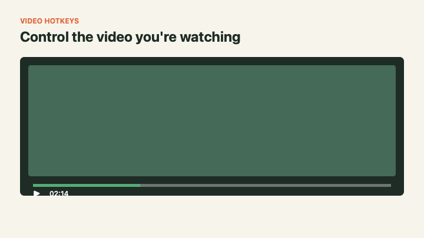

<p align="center">
   
</p>

<h1 align="center">Video Hotkeys</h1>

<p align="center">
   Seek and control playback speed on the HTML5 video you're actually watching.
</p>

<p align="center">
   
   <a href="LICENSE"></a>
   
   
</p>

## One permission. Zero network requests.

Video Hotkeys is a small, privacy-friendly Chrome and Firefox extension. It controls the currently playing video, works entirely in your browser, and has no analytics, remote code, or account requirement.

<p align="center">
   
</p>

## Features

- Seek forward or backward without opening player controls.
- Control the currently playing video on pages containing multiple videos, iframes, or shadow DOM players.
- Customize short and long seek intervals, with sensible `5` and `15` second defaults.
- Adjust playback speed from `0.5x` to `4x` in `0.25x` steps.
- Toggle Picture-in-Picture (`P`) and Fullscreen (`F`) instantly.
- Control volume with `Up/Down` and mute/unmute with `M`.
- Visual on-screen feedback (OSD) for seeking, speed, volume, and hotkey status.
- Toggle all hotkeys from the toolbar popup or keyboard.
- Preserve preferences between browser sessions.
- Avoid intercepting shortcuts while you type in editable controls.

## Shortcuts

| Action | macOS | Windows / Linux |
| --- | --- | --- |
| Forward short seek (default 5s) | `Right Arrow` | `Right Arrow` |
| Back short seek (default 5s) | `Left Arrow` | `Left Arrow` |
| Forward long seek (default 15s) | `Command + Right Arrow` | `Ctrl + Right Arrow` |
| Back long seek (default 15s) | `Command + Left Arrow` | `Ctrl + Left Arrow` |
| Increase speed | `Shift + >` | `Shift + >` |
| Decrease speed | `Shift + <` | `Shift + <` |
| Reset speed to `1x` | `Shift + ?` | `Shift + ?` |
| Picture-in-Picture | `P` | `P` |
| Fullscreen | `F` | `F` |
| Volume Up / Down | `Up` / `Down` | `Up` / `Down` |
| Mute / Unmute | `M` | `M` |
| Toggle hotkeys on/off | `Ctrl + Shift + U` | `Ctrl + Shift + U` |

Some websites or operating systems may already use one of these shortcuts. Open the extension popup to disable Video Hotkeys temporarily if a conflict occurs.

Fullscreen requires an active user gesture. If a website consumes that gesture or blocks fullscreen (for example, in a restricted embedded player), the extension shows a message instead of reporting success. Press `F` again or use the player's fullscreen controls.

## Install In Chrome

1. Download or clone this repository.
2. Open `chrome://extensions` in Chrome.
3. Enable **Developer mode**.
4. Select **Load unpacked** and choose this project folder.
5. Pin **Video Hotkeys** from Chrome's extensions menu.

After updating the project, return to `chrome://extensions` and select the reload button on the extension card.

## Install In Firefox

1. Download or clone this repository.
2. Open `about:debugging#/runtime/this-firefox` in Firefox.
3. Select **Load Temporary Add-on**.
4. Choose this project's `manifest.json` file.

Temporary extensions remain installed until Firefox restarts. Signed release builds can be submitted to Firefox Add-ons using the same WebExtensions package.

## Use The Extension

1. Open a page containing an HTML5 video.
2. Left-click the pinned extension icon to view the shortcut guide, customize seek intervals, or change the enabled state.
3. Return to the page and use any shortcut from the table above.

Right-clicking the icon opens Chrome's extension context menu rather than the Video Hotkeys popup.

## Privacy And Permissions

Video Hotkeys requests only the WebExtensions `storage` permission. It stores the enabled state and your two seek intervals locally.

The content script runs on HTTP and HTTPS pages so it can find and control HTML5 video elements. It does not collect browsing history, send page data, load remote code, or make network requests. Browser-protected pages and videos inside some embedded frames are outside the extension's reach.

## Development

The project has no runtime or development dependencies. Node.js 20 or newer is used only for validation and tests.

```bash
npm run check
```

This command validates the manifest and packaged assets, then runs behavior tests against the content scripts. The same check runs in GitHub Actions for every push and pull request.

| Path | Purpose |
| --- | --- |
| `content.js` | Page-level keyboard and video controls |
| `content-utils.js` | Shared video and shortcut helpers |
| `popup.html`, `popup.css`, `popup.js` | Toolbar guide and enabled toggle |
| `manifest.json` | Chrome Manifest V3 configuration |
| `scripts/validate.mjs` | Package and manifest validation |
| `scripts/generate-demo.swift` | Reproducible animated listing demo (macOS) |
| `test/` | Dependency-free behavior tests |

See [CONTRIBUTING.md](CONTRIBUTING.md) before opening a pull request. Security reports should follow [SECURITY.md](SECURITY.md).

## License

Released under the [MIT License](LICENSE). Copyright &copy; 2026 [Nima Karimi](https://nimakarimi.me).
