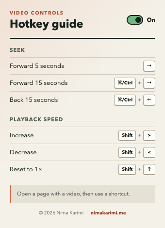

<p align="center">
   
</p>

<h1 align="center">Video Hotkeys</h1>

<p align="center">
   Seek and control playback speed on HTML5 videos without reaching for the player controls.
</p>

<p align="center">
   
   <a href="LICENSE"></a>
   
</p>

Video Hotkeys is a small, privacy-friendly Chrome extension for controlling the first HTML5 video on the current page. It has no analytics, no remote code, and no account requirement.

<p align="center">
   
</p>

## Features

- Seek forward or backward without opening player controls.
- Adjust playback speed from `0.5x` to `4x` in `0.25x` steps.
- Toggle all hotkeys from the toolbar popup or keyboard.
- Preserve the enabled setting between browser sessions.
- Avoid intercepting shortcuts while you type in editable controls.
- See compact on-page feedback after toggling or changing speed.

## Shortcuts

| Action | macOS | Windows / Linux |
| --- | --- | --- |
| Forward 5 seconds | `Right Arrow` | `Right Arrow` |
| Forward 15 seconds | `Command + Right Arrow` | `Ctrl + Right Arrow` |
| Back 15 seconds | `Command + Left Arrow` | `Ctrl + Left Arrow` |
| Increase speed | `Shift + >` | `Shift + >` |
| Decrease speed | `Shift + <` | `Shift + <` |
| Reset speed to `1x` | `Shift + ?` | `Shift + ?` |
| Toggle hotkeys | `Ctrl + Shift + U` | `Ctrl + Shift + U` |

Some websites or operating systems may already use one of these shortcuts. Open the extension popup to disable Video Hotkeys temporarily if a conflict occurs.

## Install Locally

1. Download or clone this repository.
2. Open `chrome://extensions` in Chrome.
3. Enable **Developer mode**.
4. Select **Load unpacked** and choose this project folder.
5. Pin **Video Hotkeys** from Chrome's extensions menu.

After updating the project, return to `chrome://extensions` and select the reload button on the extension card.

## Use The Extension

1. Open a page containing an HTML5 video.
2. Left-click the pinned extension icon to view the shortcut guide or change the enabled state.
3. Return to the page and use any shortcut from the table above.

Right-clicking the icon opens Chrome's extension context menu rather than the Video Hotkeys popup.

## Privacy And Permissions

Video Hotkeys requests only Chrome's `storage` permission. It stores one boolean setting locally: whether hotkeys are enabled.

The content script runs on HTTP and HTTPS pages so it can find and control HTML5 video elements. It does not collect browsing history, send page data, load remote code, or make network requests. Chrome-protected pages and videos inside some embedded frames are outside the extension's reach.

## Development

The project has no runtime or development dependencies. Node.js 20 or newer is used only for validation and tests.

```bash
npm run check
```

This command validates the manifest and packaged assets, then runs behavior tests against the real content script. The same check runs in GitHub Actions for every push and pull request.

| Path | Purpose |
| --- | --- |
| `content.js` | Page-level keyboard and video controls |
| `popup.html`, `popup.css`, `popup.js` | Toolbar guide and enabled toggle |
| `manifest.json` | Chrome Manifest V3 configuration |
| `scripts/validate.mjs` | Package and manifest validation |
| `test/` | Dependency-free behavior tests |

See [CONTRIBUTING.md](CONTRIBUTING.md) before opening a pull request. Security reports should follow [SECURITY.md](SECURITY.md).

## License

Released under the [MIT License](LICENSE). Copyright &copy; 2026 [Nima Karimi](https://nimakarimi.me).
